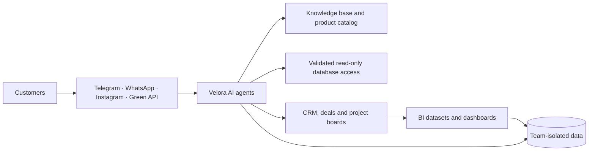

<p align="center">
  
</p>

<h1 align="center">Velora</h1>

<p align="center">
  <strong>Multi-tenant AI sales workspace for customer conversations, CRM, and self-service analytics.</strong>
</p>

<p align="center">
  Laravel 13 · PHP 8.4+ · MySQL 8 · Blade · Alpine.js · Tailwind CSS · PHPUnit
</p>

<p align="center">
  <a href="LICENSE"></a>
</p>

## Overview

Velora helps a business configure AI sales agents that answer customers through Telegram, WhatsApp, Instagram, and Green API. The same workspace gives the team a CRM pipeline, project board, knowledge base, product catalog, and BI dashboards.

The application is designed around tenant isolation: every customer-facing record belongs to a team, access is controlled by role-based permissions, and the active workspace never overrides the row-level authorization boundary.

## Product at a glance

| Surface | What it does |
| --- | --- |
| AI sales agents | Answers catalog and knowledge-base questions, qualifies intent, and captures leads. |
| Channels | Connects Telegram, WhatsApp, Instagram Direct, and Green API to one agent workspace. |
| CRM and projects | Turns conversations into customers, deals, tasks, pipelines, and accountable team work. |
| Analytics | Imports structured data and gives each team self-service dashboards without sharing datasets. |
| Team workspace | Separates tenant data and controls access through named roles and permissions. |

## What it includes

- **Omnichannel AI agents** — channel-specific drivers for Telegram, WhatsApp, Instagram, Green API, and an optional Instagram DM microservice.
- **Knowledge and product retrieval** — source ingestion, embeddings, a searchable catalog, product photos, and structured product answers.
- **Safe live database access** — validated query objects, schema snapshots, bound values, read-only sessions, query limits, and SSRF protection; no raw SQL reaches the customer's database.
- **CRM and project boards** — customers, deals, tasks, pipelines, team workspaces, roles, activity history, private boards, WIP limits, and archived work recovery.
- **Business intelligence** — upload structured files, infer a typed schema, materialize isolated analytical tables, and build interactive dashboards with ApexCharts.
- **Internationalization** — Russian, Tajik, and English, including server-rendered first paint and in-place locale switching.
- **Operational safeguards** — separate queue pools for customer messages and long-running imports, classified user-facing errors, test-only SQLite isolation, and tenant-bound policies.

## Architecture



### Data boundaries by design

- Team ownership is stored directly on the rows read by the application.
- Resource policies authorize against a record's own team, not a navigation selection.
- BI datasets materialize into per-dataset tables (`bi_ds_{id}`), so the dataset identity is part of the physical data boundary.
- The database and BI query layers accept structured specifications, not query strings; identifiers are verified against a stored schema and values are always bound.

## Technology

| Area | Choice |
| --- | --- |
| Backend | Laravel 13, PHP 8.4+, MySQL 8 |
| Frontend | Blade, Alpine.js, Tailwind CSS v4, Turbo |
| AI | OpenAI, Gemini, or Ollama through a provider interface |
| Data | Laravel queues, typed BI tables, NDJSON materialization |
| Quality | PHPUnit, Laravel Pint, tenant-isolation and SQL-shape tests |

## Engineering principles

- **Data isolation first.** Tenant identity is stored on the records that are read, and authorization evaluates the resource’s own team.
- **Safe by construction.** Live-database and BI queries use validated structures and bound values instead of accepting raw SQL.
- **Responsive operations.** Customer replies and long-running imports use separate queue pools so a large file cannot block a conversation.
- **Honest interfaces.** User-facing failures are classified and translated instead of exposing stack traces or silently losing information.

## Local setup

### Prerequisites

- PHP 8.4 or newer
- Composer
- Node.js and npm
- MySQL 8 for local development
- Python 3 only when using the optional Instagram DM service

### Install

```bash
git clone https://github.com/mirzoumarataev6/velora.git
cd velora

composer install
npm install
cp .env.example .env
php artisan key:generate
php artisan migrate
npm run build
```

Configure the database and the AI provider in `.env` before starting the application. Never commit `.env` or customer credentials.

### Run locally

```bash
# Full development stack: server, queue workers, Vite, Instagram service
composer run dev

# Backend only
composer run dev:fast
```

## Quality checks

```bash
# Runs the full PHPUnit suite with the safe test configuration
composer run test

# Format PHP
php vendor/bin/pint

# Build frontend assets
npm run build
```

> Use `composer run test`, not a bare `php artisan test`: the project clears cached configuration first and protects the test suite from targeting a real local database.

## Project structure

```text
app/
  Services/       AI, channels, CRM, BI, RAG, database access
  Jobs/           Queue-backed ingestion and messaging work
  Policies/       Tenant and role authorization
database/         Migrations, factories, demo seed data
resources/        Blade views, JavaScript, CSS, translations
instagram_service/ Optional Python service for Instagram DM support
tests/             Unit and feature coverage
```

## License

Released under the [MIT License](LICENSE).
